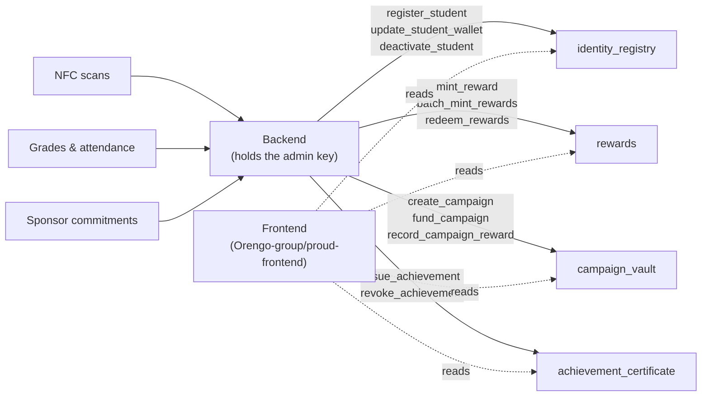

# PROUD On-Chain

[](https://github.com/Orengo-group/proud-onchain/actions/workflows/contracts-ci.yml)

PROUD (Proof of Rewards for Outstanding & Unified Development) is a student engagement and incentive platform. Students are identified by NFC tags; schools record attendance and grades; sponsors fund reward campaigns. This repository is the **on-chain layer** of PROUD — a Rust workspace of four Stellar Soroban smart contracts that hold the identity, reward, campaign and certificate records. The web application lives in a separate repository, [Orengo-group/proud-frontend](https://github.com/Orengo-group/proud-frontend), and reads from these contracts.

---

## Why on-chain

Two reasons the records belong on a ledger rather than in an application database:

- **Verifiable records.** Sponsors can check a funded pool and its allocations on-chain instead of trusting a dashboard. Schools can confirm that a certificate was issued and whether it has been revoked. Students can read their own point balance without the operator having to report it. Every state-changing call in every contract requires the administrator's authorisation, so nothing can be written except by the backend's key. The operations that move value or change status — minting points, redeeming them, funding a campaign, allocating a reward, transitioning a campaign, issuing and revoking a certificate — also publish an on-chain event, so those changes are public and auditable. (`identity_registry` publishes no events yet.)
- **Cheap enough for many small events.** A reward event is worth a few points, and a class can produce hundreds of them in a day. Stellar fees are low enough that recording each of those small events is practical, which is what makes a points-and-certificates model viable at all.

---

## Architecture

The backend is the only writer. It holds the admin key and is the party that translates real-world events (an NFC scan, a grade upload, a sponsor's funding commitment) into contract calls. The frontend does not write — only the admin can — so it reads state from the contracts.



Every contract follows the same shape: a one-time `initialize(admin)` sets the administrator, all state-changing functions require that administrator's authorisation, and all read functions are public.

---

## Contracts

| Contract | What it does today | Reference |
|---|---|---|
| `identity_registry` | Maps a hashed NFC UID to a student ID and a Stellar wallet. Admin can register a student, change their wallet, and deactivate/reactivate the record while keeping the data. Duplicate student IDs, NFC hashes and wallets are rejected. | [docs/contracts/identity-registry.md](docs/contracts/identity-registry.md) |
| `rewards` | Keeps a point balance per wallet. Admin can mint points to one or many wallets with a reason (`Attendance`, `Academic`, `Event`) and can burn them on redemption. Balances cannot go negative. | [docs/contracts/reward-points.md](docs/contracts/reward-points.md) |
| `campaign_vault` | Records sponsor-funded campaigns: creation, funding totals per sponsor, lifecycle status (`Draft`/`Active`/`Paused`/`Completed`/`Cancelled`), reward allocations against the funded pool, and a closeout summary. Allocations cannot exceed the remaining pool. | [docs/contracts/campaign-vault.md](docs/contracts/campaign-vault.md) |
| `achievement_certificate` | Issues a numbered achievement record per student (title, category, hash of the off-chain metadata, ledger sequence as the issue timestamp), and lets the admin revoke one. The record stays readable after revocation, flagged as revoked. | [contracts/achievement_certificate/src/lib.rs](contracts/achievement_certificate/src/lib.rs) |

---

## Current status

Stated plainly, because several things that the platform concept implies are not built yet:

- **Nothing is deployed yet.** The contracts exist and are tested, but this repo has no deployment script and no recorded contract IDs — the `[contracts]` block in `configs/testnet.example.toml` is still blank. A real config goes in `configs/testnet.toml`, which is git-ignored.
- **Reward points are not a Stellar asset.** A point is an `i128` balance stored inside the `rewards` contract. It is not a SAC (Stellar Asset Contract) token, it is not transferable, and it cannot be withdrawn, converted or cashed out. The contract's own doc comment lists "evaluate eligibility criteria (attendance %, grade thresholds)" as a planned responsibility — no eligibility evaluation is implemented yet; the admin decides who gets points.
- **`campaign_vault` records funding but does not custody anything.** `fund_campaign` writes down that a sponsor committed an amount. No tokens are transferred in, nothing is held, and no funds are released or refunded. `record_campaign_reward` records an allocation against that number. The "release funds on trigger" behaviour does not exist.
- **The contracts do not call each other.** There are no cross-contract invocations anywhere in the workspace. `rewards` does not check that a recipient is a registered, active student. `campaign_vault` does not mint through `rewards`. `achievement_certificate` does not check anything. Each contract is driven independently by the backend's admin key.
- **One admin key per contract.** The admin is fixed at `initialize` time; there is no transfer or rotation function, so rotating it means redeploying.
- **The WASM build is currently broken.** `scripts/build-contracts.sh` fails because `soroban-sdk` is declared with the `testutils` feature on the normal (non-dev) dependency in all four contracts, and `soroban-sdk` refuses to compile `testutils` for a `wasm32` target. The `Build WASM artifacts` step in CI fails for the same reason. Tracked separately.

---

## Getting started

```bash
git clone https://github.com/Orengo-group/proud-onchain.git
cd proud-onchain
```

The Rust toolchain is pinned by `rust-toolchain.toml` (1.81.0, including the `wasm32-unknown-unknown` target and `rustfmt`/`clippy`), so `rustup` will fetch the right one automatically.

Run the tests:

```bash
cd contracts
cargo test
```

The tests are unit tests colocated in each contract's `src/lib.rs` and use the `soroban-sdk` test harness, so they need no network and no funded account. To scope them:

```bash
cargo test -p rewards
cargo test -p identity_registry test_register_student
```

Helper scripts, run from the repository root:

| Script | What it does |
|---|---|
| `bash scripts/format.sh --check` | Checks `rustfmt` formatting across the workspace (the mode CI uses). Without `--check` it rewrites the files in place. |
| `bash scripts/lint.sh` | Runs `cargo clippy --all-targets --all-features -- -D warnings` across the workspace. |
| `bash scripts/build-contracts.sh` | Builds every contract for `wasm32-unknown-unknown` in release mode and lists the `.wasm` artifacts. |
| `bash scripts/start-localnet.sh` | Starts a local Soroban sandbox — an in-memory network that needs no internet connection and no funded account. Requires the Stellar CLI. |
| `bash scripts/configure-testnet.sh` | Registers the testnet network and identity with the Stellar CLI using the values in `configs/testnet.toml`, generating and Friendbot-funding the key if it does not exist yet. Requires the Stellar CLI. |

More detail: [docs/local-development.md](docs/local-development.md) and [docs/soroban-cli-setup.md](docs/soroban-cli-setup.md).

---

## Roadmap

1. **Cross-contract checks.** `rewards` should only mint to a student that `identity_registry` reports as registered and active, and `campaign_vault` should allocate through `rewards` rather than only recording a number.
2. **Testnet deployment.** A repeatable deployment script plus a committed `deployments/testnet.json` recording the resulting contract IDs, so the frontend has something stable to point at.
3. **Real asset custody.** Sponsor deposits should be held as an actual Stellar Asset Contract token and the remainder refunded to the sponsor when a campaign closes, rather than being recorded as a plain number.
4. **Frontend integration.** Point [proud-frontend](https://github.com/Orengo-group/proud-frontend) at the deployed contract IDs and read balances, allocations, campaigns and certificates from the chain.

---

## Contributing

See [CONTRIBUTING.md](CONTRIBUTING.md) for setup, branch naming and commit style.

One issue per pull request. Link the issue in the PR description (`Closes #N`), keep the summary line of the commit under 72 characters, and follow Conventional Commits. Before opening a PR, `cargo test`, `cargo fmt --check` and `cargo clippy -- -D warnings` must all pass — CI runs them on every pull request.

Never commit secret keys, seed phrases or `.env` files. Refer to keys by alias only.

---

## License

MIT.
